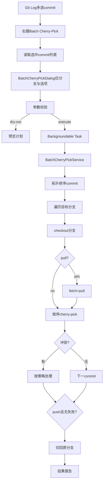

# JetBrains 批量 Cherry-Pick 插件开发计划

## 需求概述

开发一个独立的 IntelliJ Platform 插件，交互流程为：

1. 用户在 **Git → Show Git Log**（或 Log 工具窗口）中 **多选** 一个或多个 commit
2. 右键菜单点击 **Batch Cherry-Pick to Branches...**
3. 弹出对话框，**仅配置目标分支与执行选项**（不在对话框中输入 commit）
4. 确认后在后台按拓扑顺序批量 cherry-pick 到各目标分支

执行逻辑对齐现有脚本 [`script/cherry_pick_batch.py`](q:/project/SLG/slg/script/cherry_pick_batch.py) 与配置示例 [`script/cherry_pick.toml`](q:/project/SLG/slg/script/cherry_pick.toml)。

## 与现有脚本的功能映射

| Python 脚本能力 | 插件实现 |
|---|---|
| `--commits` / `--range` / `--commit-file` | **Git Log 界面多选 commit**（`VcsLog.getSelectedCommits()`），服务层按拓扑序排序 |
| `--targets` | 对话框：分支多选列表（默认本地分支，可切换显示远程跟踪分支） |
| `--pull` / `--push` | 对话框复选框 |
| `--allow-dirty` | 对话框复选框；未勾选时调用 clean 检查拦截 |
| `--on-conflict` abort/skip/theirs/ours | 对话框下拉选择，逻辑与脚本一致 |
| `--dry-run` | 对话框复选框，仅预览不执行 |
| 拓扑排序 commit | `git rev-list --no-walk --topo-order --reverse`（通过 `GitLineHandler`） |
| 执行后切回原分支 | `GitRepository.currentBranch` 保存并在 `finally` 恢复 |
| 结果汇总 | 后台任务结束后弹出结果对话框 + Notification |

## 技术选型

- **语言**：Kotlin
- **构建**：Gradle + [IntelliJ Platform Gradle Plugin 2.x](https://plugins.jetbrains.com/docs/intellij/tools-intellij-platform-gradle-plugin.html)
- **目标 IDE**：IntelliJ IDEA 2024.2+（`since-build` 242，兼容 JetBrains 全系列）
- **核心依赖**：`Git4Idea`（`bundledPlugin("Git4Idea")` + `plugin.xml` 中 `<depends>Git4Idea</depends>`）
- **Git 操作**：优先使用公开 API `git4idea.commands.Git`

## 架构设计



### 模块职责

| 类 | 职责 |
|---|---|
| `BatchCherryPickAction` | Git Log 右键入口；从 `AnActionEvent` 读取选中 commit；打开对话框 |
| `VcsLogSelectionHelper` | 封装从 Git Log 获取选中 commit 哈希、仓库根、提交摘要 |
| `BatchCherryPickDialog` | UI：**只读展示**已选 commit 列表 + 目标分支多选 + 执行选项 |
| `BatchCherryPickService` | 核心业务：排序 commit、切换分支、cherry-pick、冲突处理、pull/push |
| `CherryPickOptions` | 不可变配置（remote、targets、selectedCommits、flags、conflictStrategy） |
| `BranchCherryPickResult` / `BatchCherryPickReport` | 结构化执行结果 |
| `GitCherryPickHelper` | 封装 git 命令与冲突检测 |

## 核心文件结构（独立仓库）

```
batch-cherry-pick-plugin/
├── build.gradle.kts
├── settings.gradle.kts
├── gradle.properties
├── README.md
└── src/main/
    ├── kotlin/com/windforce/git/cherrypick/
    │   ├── action/BatchCherryPickAction.kt
    │   ├── util/VcsLogSelectionHelper.kt
    │   ├── ui/BatchCherryPickDialog.kt
    │   ├── ui/CherryPickResultDialog.kt
    │   ├── service/BatchCherryPickService.kt
    │   ├── service/GitCherryPickHelper.kt
    │   ├── model/CherryPickOptions.kt
    │   ├── model/ConflictStrategy.kt
    │   └── model/BatchCherryPickReport.kt
    └── resources/
        ├── META-INF/plugin.xml
        └── messages/BatchCherryPickBundle.properties
```

## 关键实现细节

### 1. plugin.xml 注册（Git Log 右键菜单）

```xml
<idea-plugin>
  <id>com.windforce.batch.cherrypick</id>
  <name>Batch Cherry-Pick</name>
  <depends>com.intellij.modules.platform</depends>
  <depends>Git4Idea</depends>

  <actions>
    <action id="BatchCherryPickAction"
            class="...BatchCherryPickAction"
            text="Batch Cherry-Pick to Branches..."
            description="将 Git Log 中选中的 commit 批量 cherry-pick 到多个分支">
      <add-to-group group-id="Vcs.Log.ContextMenu" anchor="after" relative-to-action="Git.CherryPick"/>
    </action>
  </actions>
</idea-plugin>
```

- 注册到 `Vcs.Log.ContextMenu`，紧邻内置 `Git.CherryPick` 之后，符合用户心智
- **不注册 VCS 主菜单**，入口仅限 Git Log

### 2. 从 Git Log 读取选中 commit（`VcsLogSelectionHelper`）

```kotlin
fun getSelectedCommits(event: AnActionEvent): SelectedCommits? {
    val log = event.getData(VcsLogDataKeys.VCS_LOG) ?: return null
    val selected = log.selectedCommits
    if (selected.isEmpty()) return null

    // 解析为完整 hash + 提交信息（用于对话框只读展示）
    val hashes = selected.map { it.asString() }
    val repository = resolveRepository(event.project, selected.first().root)
    return SelectedCommits(repository, hashes, selected)
}
```

- `update()` 中：无 Git 仓库、未选中 commit、选中 commit 跨多个不相关仓库根时 **禁用** Action
- 多选 commit 来自同一 `GitRepository` 根目录；跨根目录选中时提示「请选择同一仓库下的 commit」

### 3. 对话框 UI（`BatchCherryPickDialog`）— 不含 commit 配置

- **已选 Commit 区（只读）**：
  - `JBList` 或 `Table` 展示：短 SHA、提交说明、作者、时间
  - 顶部摘要：「已选择 N 个 commit，将按拓扑顺序应用」
  - 不提供 SHA 输入框、范围输入、文件导入
- **目标分支**：`CheckBoxList` + 搜索过滤；数据源 `repository.branches.localBranches`（可选「显示远程跟踪分支」）
- **选项区**：Remote（默认 origin）、Pull、Push、Allow dirty worktree、Dry run
- **冲突策略**：`ComboBox<ConflictStrategy>`（ABORT / SKIP / THEIRS / OURS）
- **按钮**：「预览」/「执行」；执行前二次确认（N 个 commit × M 个分支）

### 4. Action 启用条件（`BatchCherryPickAction.update`）

| 条件 | 行为 |
|---|---|
| 无 Git 仓库 | `enabled = false` |
| Git Log 未选中 commit | `enabled = false` |
| 选中 commit 跨多个 repo 根 | `enabled = false`，`description` 提示原因 |
| 正常选中 ≥1 个 commit | `enabled = true` |

### 5. 业务服务（`BatchCherryPickService`）

- 输入 commit 列表直接来自 Action 传入的 `SelectedCommits`，不再从对话框解析
- 服务层对选中哈希执行 `rev-list --no-walk --topo-order --reverse` 拓扑排序（与脚本 `gather_commits` 一致）
- 其余流程（checkout → pull → cherry-pick 循环 → push → 恢复原分支）不变

### 6. 结果展示

- `CherryPickResultDialog`：按分支展示 applied / skipped / failed
- `NotificationGroup` 推送摘要
- 存在 failed 时 WARNING 级别，提示检查残留 cherry-pick 状态

### 7. 国际化

- `BatchCherryPickBundle.properties`（英文）
- `BatchCherryPickBundle_zh_CN.properties`（中文，推荐）

## 用户操作流程（README 核心内容）

```
1. 打开 Git Log（VCS → Git → Show Git Log）
2. Ctrl/Shift 多选需要 cherry-pick 的 commit
3. 右键 → Batch Cherry-Pick to Branches...
4. 在对话框中勾选目标分支，配置 pull/push/冲突策略
5. 点击「执行」，等待后台完成并查看结果报告
```

## 测试与验证计划

1. **Sandbox 运行**：`runIde` 导入多分支 Git 仓库
2. **场景覆盖**：
   - Git Log 单选 / 多选 commit → Action 正确启用
   - 未选中 commit 时 Action 禁用
   - 多 commit 乱序选中 → 验证拓扑排序正确
   - 多分支批量执行 → 验证切回原始分支
   - 冲突策略 abort/skip/theirs/ours
   - pull/push、dirty worktree、dry-run
3. **Plugin Verifier**：`verifyPlugin` 检查 API 兼容性

## 风险与约束

- commit 来源**仅限 Git Log 界面选中**，不支持命令行式 SHA/范围输入（与 Python 脚本差异点，属有意简化）
- 跨仓库根多选 commit 不支持，需在 UI 明确提示
- theirs/ours 自动解决为尽力策略，复杂冲突可能失败
- push 失败不自动回滚本地 cherry-pick，结果报告中标记

## 开发任务拆分

### 任务 1：工程脚手架
- 初始化独立 Gradle 工程、plugin.xml、Kotlin 工具链、Git4Idea 依赖

### 任务 2：数据模型与 Git 工具层
- `CherryPickOptions`、`ConflictStrategy`、`BatchCherryPickReport`
- `VcsLogSelectionHelper`：从 Git Log 读取选中 commit
- `GitCherryPickHelper`：rev-list 排序、clean 检查、cherry-pick/abort/continue

### 任务 3：核心业务服务
- `BatchCherryPickService` 完整批量流程（对齐 Python 脚本执行段）

### 任务 4：UI 与 Action
- `BatchCherryPickAction` 注册到 `Vcs.Log.ContextMenu`，含 `update()` 启用逻辑
- `BatchCherryPickDialog`（只读 commit 展示 + 分支/选项配置）
- `CherryPickResultDialog` 结果展示

### 任务 5：打磨与文档
- 中英文 Bundle、README（含操作流程说明）
- Sandbox 场景测试与 Plugin Verifier
